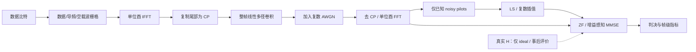

# SignalLab AI v1.3 技术设计：OFDM 与频率选择性多径

状态：2026-10-26 用户以“开始”批准开发。本文件保留研发前数学设计；实现先交付全训练 LS 基线，梳状导频延期，不新增 NumPy，不执行正式大规模研究。实际交付和验证见 `signallab-v13-implementation.md`。
基础版本：v1.2 发布提交 `afa678bd0523d58f51a31be51b70b215b66d9ebc`。

## 1. 目标与范围

构建可解释、可复现的 SISO CP-OFDM 链路：比特与资源栅格 → 单位酉 IFFT → CP → 连续线性多径卷积与 AWGN → 去 CP / FFT → 导频 LS → 理想/估计 CSI 的 ZF / 标量 MMSE → 判决、BER/EVM 与信道诊断。

必需范围：BPSK/QPSK/16QAM，复数基带，FFT/IFFT、DC/保护载波、CP 充分/不足对照，确定性抽头与块静态 Rayleigh 多径，全带宽训练 OFDM 符号 LS，逐子载波 ZF/MMSE，理想 CSI 对照，独立参考、Worker、版本化本地记录及图表。

建议同一版本的第二小阶段加入梳状导频与复数线性插值，用来研究插值偏差、导频开销和信道失配。DFT/时域抽头 LS、LMMSE 信道估计不列入首发必须项。

不做：MIMO、FEC、交织或自适应调制，CFO/定时恢复与 OFDM 联合仿真，符号内多普勒，分数采样时延，脉冲成形/射频前端、PAPR 削波，标准兼容性认证，GPU/WASM，新增云同步或数据库表。v1.1 载波研究继续独立存在。

## 2. 当前架构与扩展约束

实际仓库是 React/Vite/TypeScript 应用，并有独立 Node RSS/AI 后端；数值仿真位于浏览器 Web Worker，不需要把 OFDM 放到服务器。

| 现有模块                                                                              | 已核实职责                                         | v1.3 处理                                                                  |
| ------------------------------------------------------------------------------------- | -------------------------------------------------- | -------------------------------------------------------------------------- |
| `react-app/src/lib/signallab.ts`, `qpsk.ts`, `qam16.ts`                               | 原有调制、硬判决、能量定义；有公开函数             | 只读调用公开调制函数，新适配层转换为 Float64Array；不修改原文件            |
| `channelSimulation.ts`, `flatFading.ts`, `channelEstimator.ts`, `channelEqualizer.ts` | v1.2 平坦信道、恒定 LS、ZF；部分调制辅助函数为私有 | 保持原字节；不把 OFDM 塞进平坦信道枚举，不为复用私有函数而改写冻结依赖闭包 |
| `fadingRandom.ts`                                                                     | 冻结 SHA-256 → xoshiro128\*\* / Box–Muller 流      | 可复用公开 PRNG 原语；另建 OFDM 随机域及版本，不改变 v1.2 seed/role 字符串 |
| `channelResearch.ts` / `channelResearchRecord.ts`                                     | 计划、帧级统计、校验和版本协议                     | 保留；新建 OFDM 计划、统计与解析器，不能给旧记录补默认 OFDM 字段           |
| `channelResearchStore.ts`                                                             | v1.2 独立 IndexedDB、CAS、两条历史及检查点         | 新建数据库，复用事务设计，不迁移旧库                                       |
| `channelResearch.worker.ts`                                                           | 每次运行一个 Worker，runId/hash、批次与完成校验    | 新建 OFDM Worker；可借鉴协议，不混用 Worker 消息类型                       |
| `ChannelResearchExperiment.tsx` / Charts                                              | 参数确认、取消/恢复、SVG 图表与本地导出            | 新建组件，延迟加载并附加在原实验之后                                       |
| `scripts/channel-*.mjs`, `channel-reference.py`                                       | 冻结研究、独立参考、流式审计与基准                 | 新建 OFDM 工具及数学参考；旧研究脚本、源码快照和大归档不改                 |
| `experimentHistory.ts`, `experimentCloud.ts`, Supabase schema                         | 既有引导实验账号同步                               | 不变；OFDM 研究不进入云队列                                                |

v1.2 的源码/运行时指纹对字节敏感。即使不改变数值结果，向其冻结 lib 增加 export 或重排格式也会改变指纹；优先以新模块适配现有公开函数，不能以“函数行为没变”替代兼容性验证。

## 3. 复数基带、FFT 与能量约定

### 3.1 资源与变换

FFT 长度 N 为 2 的幂，首发范围 64/128/256/512/1024。频域内部使用标准顺序 k=0…N−1；显示用有符号索引 q∈[−N/2,N/2−1]，映射 k=(q+N) mod N。fftshift 只用于显示，不改变内核存储。

数据、导频和空载波集合 D/P/Z 两两不交并覆盖全部 N；DC 和保护载波为 0。复杂基带不施加实信号的 Hermitian 对称约束。

采用双向单位酉约定：

$$
x_m[n]=\frac{1}{\sqrt{N}}\sum_{k=0}^{N-1}X_m[k]e^{j2\pi kn/N},\qquad
Y_m[k]=\frac{1}{\sqrt{N}}\sum_{n=0}^{N-1}y_m[n]e^{-j2\pi kn/N}.
$$

因此 Σ|x|²=Σ|X|²。NumPy 对照必须显式使用 `norm="ortho"`；不能依赖默认 inverse=1/N 的约定。[NumPy 变换与归一化定义](https://numpy.org/doc/2.2/reference/routines.fft.html#normalization)。

原调制保持 Eb,data=1：每数据符号 b=log₂M 比特，平均 Es=b，即 BPSK/QPSK/16QAM 为 1/2/4。不按每帧实际星座平均能量重新缩放。导频为冻结的公开 QPSK 训练序列，已知非零值，Ep=Es 为首发默认；其序列、位置与 hash 属于协议。

### 3.2 CP 与发送能量

长度 C 的 CP 是 x[N−C…N−1]，C=0 时为空；每 OFDM 符号实际发送 N+C 个复数采样。采用离散归一化采样能量，采样间隔单位为 1；N0 指每复数采样噪声能量，不直接当作连续时间噪声功率谱密度。

设整帧有效信息位数 B=bΣ_m|D_m|，固定导频时域贡献为 x_p,m[n]。数据独立、零均值时：

$$
E_{0,m}=|D_m|E_s+\sum_{p\in P_m}|X_m[p]|^2,
$$

$$
\mathbb{E} E_{CP,m}=\frac{C}{N}|D_m|E_s+
\sum_{n=N-C}^{N-1}|x_{p,m}[n]|^2,
$$

$$
E_{b,total}=\frac{\sum_m(E_{0,m}+\mathbb{E} E_{CP,m})}{B}.
$$

整帧包括全训练符号；它耗能但不贡献 B。记录实际 useful/CP/pilot/total 能量及实际每位能量作为诊断。固定导频的 CP 能量不必等于 C/N 倍导频能量，不能无条件套 `(1+C/N)`，也不能忽略训练符号。

实际 CP 的数据/导频贡献若拆分，还需记录交叉项 `2 Re Σ x_d[n] x_p[n]*`；截断 CP 窗口中的两部分并不保证正交。期望交叉项为零不等于某帧实际交叉项为零。另列 CP 样本占比 C/(N+C)、训练/梳状 pilot RE 占比、空载波占比与 `B/总发送采样数`（bits/complex sample），不把这些不同分母的比例相加或直接称作实测 bits/s/Hz。

两种独立 SNR 口径：

- data Eb/N0：N0=1/γ_data。
- total Eb/N0：N0=Eb,total/γ_total，其中 Eb,total 用上述计划期望值，在计算前冻结。
- 等效 γ_data=γ_total/Eb,total；在同一 total Eb/N0 下增加 CP 或导频通常降低有效数据 SNR。
- 噪声 N0 按协议一次确定；不随某个随机载荷的实际能量或衰落后的接收功率调整。另列 `sample SNR=mean tx sample power/N0`，不把它混称为 Eb/N0。

## 4. 多径信道与 CP 的适用条件

信道用排序、去重的非负整数时延 d_l 与复数增益 h_l 表示，最大时延 Dmax<N，非零路径最多 16。固定接收定时下 CP 条件是 C≥Dmax，而非仅 max(delay)−min(delay)。

$$
r[t]=\sum_l h_l s[t-d_l]+w[t],\quad
w[t]\sim\mathcal{CN}(0,N_0),\quad
\operatorname{Var}(\Re w)=\operatorname{Var}(\Im w)=N_0/2.
$$

信道核对整帧连续 CP 波形做因果线性卷积；前史明确设为 0，符号间保留 FIR 状态，不逐 OFDM 符号清零。卷积尾部可用于独立诊断，不当作新增发送能量；所有被发送的符号都计入能量。

- AWGN：h=[1], d=[0]。
- 确定性多径：用户定义延迟和复数增益，记录明确的归一化方式；固定能量对照可一次归一化到 Σ|h|²=1，不能悄悄缩放。
- Rayleigh 多径：固定 PDP p_l≥0、Σp_l=1；每个独立 trial 抽取 h_l=√p_l g_l，g_l 独立 CN(0,1)。整帧训练和数据期间不变；不同 trial 独立。只归一化 PDP，不对每次随机 h 再做单位范数归一化。
- 不模拟逐符号独立抽头或符号内 Doppler；如未来引入，必须新模型、新参考和新协议，不能混入当前对角模型。

当 CP 充分、抽头在帧内不变且定时正确：

$$
Y_m[k]=H[k]X_m[k]+W_m[k],\qquad
H[k]=\sum_l h_l e^{-j2\pi kd_l/N}.
$$

这里 H 是抽头的**未归一化 DFT**；若调用单位酉 FFT 求 H，需额外乘 √N。h=[1] 必须得到 H[k]=1，不能得到 1/√N。单位酉接收 FFT 后仍有 E|W[k]|²=N0，不能再乘 N 或除 N。

每个独立 trial 明确从零前史开始，不冒充跨帧连续物理包流。CP 不足时按同一连续卷积产生 ISI/ICI，不能用 `Y=H*X+W` 的频域捷径生成波形，否则会把要研究的失效隐藏掉。首训练符号、受训练尾部干扰的首数据符号、后续数据符号分开诊断。此时“理想 CSI”仅是已知对角 H 的单抽头参考，不是已知完整 ISI/ICI 系统的最优检测器；LS 也不再是单纯 H 加独立噪声。CP 不足不保证每个特殊数据/信道都产生误码，不写这种脆弱断言。CP 转换线性/循环卷积的条件参见 [MathWorks CP 说明](https://www.mathworks.com/help/comm/gs/equalization-convolution-and-cyclic-prefix-addition.html)。

## 5. 导频 LS 与理想 CSI

### 必需基线：全带宽训练符号

每帧先发 T=1 个训练 OFDM 符号，在所有后续使用的非空载波上发送已知导频；随后发 S 个数据 OFDM 符号。数据块没有插值需求：

$$
\hat{H}[k]=Y_{train}[k]/P[k].
$$

CP 充分时 E|Ĥ[k]−H[k]|²=N0/Ep；若明确扩展到 T 次独立训练噪声平均，则为 N0/(T Ep)。不能直接套用 v1.2 的跨时间 P 个导频估计同一标量 h 的 MSE。

### 第二小阶段：梳状导频 + 复数线性插值

在每个数据 OFDM 符号选择 P 个已知导频，先计算 Hp=Yp/Pp，再按实际有符号频率坐标对实部和虚部线性插值。占用频带两端必须有导频，首发不外推；跨 DC 的空洞按真实间距计算，不对相位角直接插值，不跨保护带声称存在观测。默认 N128 时活动载波为 ±1…±48；P=8 示例为 −48,−34,−21,−7,7,21,34,48，剩余 88 个数据载波。

若 Ĥ_D=A Ĥ_P，CP 充分且导频噪声独立，条件于固定 h 的数据频点误差为：

$$
\mathbb{E}|\hat{H}_D[k]-H_D[k]|^2=
|(A H_P-H_D)[k]|^2+N_0\sum_p|A_{kp}|^2/|P[p]|^2.
$$

第一项是插值偏差；高 SNR 下不一定消失。导频位置/间距需相对时延扩展解释，不以“导频数量足够”替代可辨识性。资源栅格和公开导频定义参见 [MathWorks 导频说明](https://www.mathworks.com/help/comm/ug/ofdm-channel-estimation.html)。

实际接收器只读取 noisy pilot、导频配置和声明的 N0/Es；不能读取真实 h、真实 H 或干净数据。真值仅用于信道生成、明确标记的 ideal 分支与事后评价。理想/估计分支发送完全相同的训练、CP、载荷和噪声；无导频 oracle 若研究，必须另列开销基准，不能混成同预算算法比较。

CP 不足格的标量解析 BER/MSE 标签为“不适用”；如果绘制充分 CP 的理论线作对照，需明确标为外部参考，不能对这些格执行同一覆盖断言。

## 6. ZF/MMSE：必须防止错误的 BER 改善结论

逐子载波、同一 CSI 输入 Ĥ 的均衡器：

$$
W_{ZF}=1/\hat{H},\qquad
W_{MMSE}=\frac{\hat{H}^{*}}{|\hat{H}|^2+N_0/E_s},\qquad z=WY.
$$

这里的 MMSE 限定为复数线性标量均衡；BPSK 不扩展到 widely-linear 接收机。LS-CSI 分支是将 Ĥ 代入的 plug-in MMSE，不宣称对信道估计误差分布仍是 Bayes 最优或鲁棒 LMMSE。

MMSE 的收缩增益 G=W_MMSE Ĥ=|Ĥ|²/(|Ĥ|²+N0/Es)。16QAM 不能直接把 z 交给原单位增益门限；必须对照 G 倍星座判决，或使用数值稳定的等价信道域距离判决。N0 暂作为接收器已知的仿真参数，明确标注，不宣称已实现噪声估计。

**代数边界：在非零 CSI、标量 SISO、未编码硬判决、同一 Ĥ 且正确处理 G 时，z_MMSE/G=Y/Ĥ。因此 MMSE 和 ZF 的硬判决应一致。** 不把收缩后 16QAM 固定门限的差异、自动去掉深衰落或不同归一化造成的假象宣传为 BER 提升。MMSE 本版主要研究原始输出的 MSE/正则化与数值行为；若要获得编码 BER 或 MIMO 检测收益，需要新的范围批准。

报告两种输出口径：未去偏的均衡输出 EVM/MSE（包含 MMSE 收缩偏差），以及按接收器已知 G 处理的判决坐标/等效 EVM。不得用真值拟合增益后只展示较好一条曲线。基础均衡形式参考 [MathWorks ofdmEqualize](https://www.mathworks.com/help/comm/ref/ofdmequalize.html)，上述 Es 缩放、门限和 BER 等价性是本设计对标量公式的显式推导。

理想 CSI 的条件 MSE 参考：ZF 为 N0/|H|²；MMSE 为 Es N0/(Es|H|²+N0)。给定 H 与 Ĥ 的失配参考为 Es|W(Ĥ)H−1|²+N0|W(Ĥ)|²；只在对角模型成立、数据与导频/数据噪声满足相应独立性时使用。

深衰落不截断、不按成功事件筛样。非零但很小的 CSI 保留实际数值和深衰落诊断；零 CSI、溢出、非有限结果分别记失效/擦除，保存其比特权重。Ĥ=0 时两种方法采用同一明确擦除规则，不能把 MMSE 的有限 z=0 当成已恢复信息。不能悄悄加 epsilon 或删载波。理想 Rayleigh ZF 的总体均方 EVM 仍可能发散；去偏后的 MMSE 坐标也不能消除该事实。

## 7. 独立正确性验证

预先登记的定性预期：CP 已充分时，固定 data Eb/N0 下继续增加 CP 不应凭空改善恢复；固定 total Eb/N0 则要承担新增 CP 能量开销。CP 不足可出现 ICI/ISI 和高 SNR 性能底限，但不要求所有特殊数据/信道都出现底限。深衰落使 ZF 放大噪声，MMSE 原始输出的收缩改善 MSE 不自动转化成未编码 BER 改善。全训练 LS 的误差随训练能量/SNR 改善；梳状插值的模型偏差可在噪声趋零后保留。以上区分总体预期与某个有限样本的排序。

不以 IFFT→FFT 能往返、TS 内核与自身审计相同就宣布数学正确。

1. **独立确定性参考**：Python 标准库 `cmath`，直接 O(N²) DFT/IDFT、普通时域线性卷积、小型块 Toeplitz 矩阵；不导入 TS、项目 PRNG 或仿真输出作为答案。N=8/16/32 的手工序列生成已知 fixture。可再加锁定版本 NumPy `fft(...,norm='ortho')` / `convolve` 作第三方数值交叉核对。
2. **变换基本向量**：冲激、常量、单音（含负频率）、Nyquist 边界和已知复数向量；检查方向、幅值、Parseval 和标准 bin 顺序。逆变换与正变换互相抵消的双重缩放错误必须能被检出。
3. **信道定理**：h=[1]、单纯延迟、非退化两/四径；C≥Dmax 时，直接时域链路与 H[k]X[k] 一致。H 参考用直接未归一化 DFT，独立于生产 FFT。
4. **不足 CP**：连续发送至少三个不同 OFDM 符号，与小型完整线性通道矩阵比较当前块非对角项和上一块耦合；首符号零前史效应单列，后续符号不清空状态。不要只检测 BER 单调性。
5. **噪声/能量**：独立小样本预算核对每轴 N0/2、FFT 后 N0；时域、资源栅格、CP 实际和期望能量分别比较。训练 CP 的确定性贡献需用直接 DFT 参考核对。
6. **已知理论**：AWGN + 充分 CP + 理想 CSI 的 BPSK/QPSK BER 为 Q(√(2γ_data))；16QAM 用已有独立判决积分。独立 Gaussian 抽头、Σp=1 时每个 H[k] 的边缘为 CN(0,1)，故充分 CP 的未编码 ideal BER 与单径 Rayleigh 边缘理论一致；子载波相关性只改变统计相关结构，不能无编码就宣称获得多径分集收益。
7. **估计与均衡**：全带训练 LS 的 N0/Ep、梳状插值偏差/噪声协方差、理想/失配条件 MSE；同 CSI 的 ZF/MMSE 判决逐位一致，N0→0 时二者相容。
8. **边界**：C=0 且 h=[1]；C=Dmax 和 Dmax−1；无导频时估计分支拒绝而 ideal 可单独运行；导频越界/重叠/DC/重复/零值拒绝；零信道、深陷波、低 SNR、最大 N 与路径数、非法 PDP 和非有限输入。

集成深陷波可用两径在一个活动数据载波制造零点；必须选活动 bin，不能只把零点放在已置零的 DC。浮点近零与严格零分别验证；无噪声零 BER 断言仅用于已限定最小增益的非退化 fixture。

目标容差：单位幅值、N≤1024 的确定性参考比较相对 L2≤1e−10，近零分量采用绝对容差 1e−12；解析理论跨语言相对 1e−10。它们是待独立 fixture 实测后冻结的验收门槛，不是本轮已经得到的 v1.3 结果。随机统计检验预先固定显著性和样本，不能失败后任意放宽阈值。

## 8. 随机协议、配对与统计

新随机域 `signallab-ofdm-rng-v1`，主 seed 为 uint32。建议固定 SHA-256 输入为 ASCII `signallab-ofdm-rng-v1|<seed>|<trial>|<role>|<slot>`，十进制整数无补零，前 16 字节按四个 little-endian uint32 初始化 xoshiro128\*\*，均匀数为 uint32/2³²，复 Gaussian 为 Box–Muller 成对结果除 √2。channel 角色 slot=0，按固定 tap ordinal 取样；逻辑数据 slot 在可配置 S 范围内独立派生。数据对所有 N 个标准 bin 固定消费四个虚拟 bit，不能因某 bin 是 pilot/null 而少取随机数。训练噪声、数据 useful-body 噪声、CP 噪声与统计重采样使用不同 role。公开导频使用另行固定的公开序列与序列 hash，不读取主数据流。

整数 PRNG 向量逐字节核对；跨 JS 引擎的 sin/cos、FFT 和边界判决须记录运行时并按容差评估，不能承诺所有平台浮点末位及贴边判决都字节相同。复用原语不改变旧随机协议。

最小独立统计单位是一个完整帧：一次抽头实现、T 个训练与 S 个数据 OFDM 符号。不是 bit，也不是相关子载波或同一块信道下的多个 OFDM 符号。

- 同帧各算法读取同一 noisy 接收波形；跨 SNR 共用标准噪声后缩放。
- 跨导频布局使用固定 `(trial, logical data-symbol slot, signed bin, bit)` 的虚拟载荷；报告全数据指标和共同数据交集指标。
- 跨 CP 使用冻结的逻辑 useful-sample 噪声索引，prefix 部分独立分域；不能让增加 CP 改变数据种子。跨 N 不宣称逐载波自然配对。
- BER 主区间：以 F 个 frame BER∈[0,1]，半径 √(ln(2/α)/(2F))。配对差∈[−1,1] 的半径 √(2ln(2/α)/F)。没有独立帧假设便不发布这些区间。
- 失败帧不丢弃：BER 保留全样本分母，无法确定的比特给出下/上界及失败数；缺失误码时点估计为 null，区间扩展覆盖缺失取值，不能只报成功帧 BER。
- frame bootstrap 仅为明确标注的近似辅助，使用独立固定统计流；同时声明逐格/逐比较区间与多重比较的区别。
- EVM 保留 frame P50/P90/P99、最大值、pooled RMS 及有效/失败分母；不套 BER 的有界 Hoeffding。信道 NMSE 用总体误差和真值能量之比，并区别逐帧相对误差平均的深衰落长尾。
- 固定样本完成后才发布完整研究统计；取消、耗时预算停止或失效只生成可复核前缀检查点。不得按达到某个误码数或看到显著结果提前结束。

## 9. 建议默认值、实验协议与性能预算

默认草案：QPSK，N=128，C=16，活动 bin ±1…±48；全训练 T=1、数据 S=4；Ep=Es；F=200；Eb/N0=[0,8,16]；AWGN 与 Rayleigh 四径，延迟 [0,1,3,7]，相对 PDP [0,−3,−6,−9] dB 后按期望总功率归一化。共 6 格、1,200 cell-frame。逐符号模型不启用。

研究分三层，全部需正式开发批准后执行，本轮均未运行：

| 层级         | 内容                                                                 | 预算与结论                                                                                     |
| ------------ | -------------------------------------------------------------------- | ---------------------------------------------------------------------------------------------- |
| 确定性正确性 | 小 N 黄金向量、直接 DFT/FIR/矩阵、能量与均衡解析式                   | 小型 CI fixture；不依靠 Monte Carlo 判断数学定义                                               |
| 筛查 pilot   | 基线 3 调制×2 信道×5 SNR，共 30 格；F=200；CP/插值边界另作小型预定组 | 先测吞吐；F200 的单 BER Hoeffding 半宽约 0.096，不能据微小差异选优；只定位数量级错误和严重失配 |
| 正式研究提案 | 预先选定主比较、误差精度、CP 充分/不足、全训练/梳状、两种能量口径    | 不先铺开笛卡尔积；根据实测吞吐向用户提交计算量和固定 F，再单独批准                             |

例如单 BER 点区间半宽 ε=0.02、95% 需要 F≥4,612；配对差同样半宽需要 F≥18,445。这是保守界，并不承诺有限时间一定显著。不能直接沿用 v1.2 的样本量或“189 格全跑”的惯例。

以下均是工程目标，不是已测结果：

- 浏览器 N≤1024、S≤8、非零路径≤16、计划 cell-frame≤4,000、静态 work-unit 预算≤50,000,000；超预算拒绝，不能自动减少样本。
- work-unit 定义需冻结：帧数×格数×[2(T+S)Nlog₂N +(T+S)(N+C)L_nonzero + 均衡/指标开销]。默认约为千万数量级；P0 先通过小基准校准系数，不能把该估计当成 CPU 时间。
- 时域稀疏 FIR 复杂度按非零路径数计；FFT 用 Float64Array、预计算有界计划/位倒序/旋转因子。逐帧复用缓冲，不保留所有 IQ 样本。
- 默认桌面 Chromium 端到端目标≤5s；主线程同步消息处理 P95<50ms，取消反馈≤100ms。消息节流约 100ms；预览≤256 星座点/方法，频响最多 512 个显示点，指标仍使用完整载波。
- 目标单 Worker 工作集≤64MiB（需实测峰值与范围）；记录和浏览器传输另设字节上限，不能把 V8 old-space 限额当作整进程内存。
- 原百万 bit BER 数值必须逐值一致；同机同环境中位耗时回归≤10%。标准桌面、移动视口、Firefox/WebKit 与实体 iPad 的证据等级继续分开。
- 正式离线工具流式分组、有限检查点、协议/源码/运行时 fingerprint；未经批准不运行大矩阵，不自动使用 GPU 或云算力。

## 10. 模块清单与交付顺序

以下是预计新增/修改路径，并非本轮已经实现。

| 优先级 | 模块/文件                                                                                                                           | 职责与验收 gate                                                                              |
| ------ | ----------------------------------------------------------------------------------------------------------------------------------- | -------------------------------------------------------------------------------------------- |
| P0     | `src/lib/ofdmTypes.ts`, `ofdmEnergy.ts`, `ofdmProtocol.ts`                                                                          | 数学与索引、资源/能量验证、版本化参数；冻结变换与噪声约定                                    |
| P0     | `scripts/ofdm-reference.py`, `tests/fixtures/ofdm-v13-reference.json`, `tests/ofdm-reference.test.mjs`                              | 独立直接 DFT/FIR/小矩阵和解析参考；先证明黄金向量能检出缩放/方向错误                         |
| P1     | `src/lib/fft.ts`, `ofdmModulation.ts`, `ofdm.ts`, `multipathChannel.ts`                                                             | 纯 TS radix-2、原调制适配、CP/FFT 与连续卷积；不能用频域乘法代替生产信道                     |
| P1     | `tests/fft.test.ts`, `ofdm.test.ts`, `multipath.test.ts`                                                                            | 单音/Parseval、CP 阈值、首块与后续 ISI、理论极限                                             |
| P2     | `src/lib/ofdmPilots.ts`, `ofdmEstimator.ts`, `ofdmEqualizer.ts`                                                                     | 全训练 LS、增益感知 MMSE 与 ZF、理想 CSI；随后梳状+插值；逐位判决等价与 MSE gate             |
| P2     | `src/lib/ofdmRandom.ts`, `ofdmStatistics.ts`, `ofdmResearch.ts`                                                                     | 新随机域、配对、帧统计与失败保留；不抽取/改写旧私有函数                                      |
| P3     | `ofdmResearchRecord.ts`, `ofdmResearchStore.ts`, `workers/ofdmResearch.worker.ts`                                                   | 严格解析、engine/hash/runId、独立 IndexedDB/CAS、取消/恢复与陈旧消息拒绝                     |
| P3     | `components/OfdmResearchExperiment.tsx`, `.css`, `OfdmResearchCharts.tsx`                                                           | 栅格/CP/PDP 参数、BER/EVM、真值/估计频响、星座图；错误与边界可见                             |
| P3     | 修改 `src/pages/SignalLab.tsx` 及必要样式                                                                                           | 增加延迟加载入口、放在现有实验之后；按真实 sticky 导航高度校验锚点，不让模块晚加载移动原控件 |
| P4     | `scripts/study-ofdm-research.mjs`, `inspect-ofdm-research.mjs`, `ofdm-study-manifest.mjs`, `benchmark-ofdm-research.mjs`            | 冻结/流式研究/审计/性能；先 register/小样本，正式算力需批准                                  |
| P4     | `tests/ofdm-record.test.ts`, `ofdm-store.test.ts`, `e2e/ofdm-research.spec.ts`, `e2e-pages/pages.spec.ts`, `e2e-cloud/sync.spec.ts` | 数学、损坏导入、CAS、Worker 生命周期、Pages 子路径、登录后不上传与旧版回归                   |
| P4     | 修改 `package.json` / CI 文档及必要测试配置                                                                                         | 新工具命令、独立参考 gate、构建与回归；不得触发未经批准的大研究                              |

上述相对路径均位于 `react-app/` 下。研发顺序为 P0→P1→P2→P3→P4；核实数学之前不先铺复杂 UI。工程粗估 8–13 个工作日，梳状布局复杂度、参考依赖及审批等待会影响范围；正式研究计算量另行估计。

## 11. 兼容、存储与回滚

拟定独立 `engineVersion=ofdm-v13.1`、`randomVersion=signallab-ofdm-rng-v1`、`schemaVersion=1` 与 IndexedDB `signallab-ofdm-research-v13`。协议 hash 包含 FFT 约定、活动/空/导频 bin、训练序列、CP、PDP、帧结构、N0 口径、均衡/判决和统计规则。导出完整方案、逐帧计数、能量、估计误差、数值失败与有限预览。

保留 v1.2 的独立数据库和解析器；新旧 JSON 不互相伪装升级，旧记录不重新计算。新 Worker 每次运行独占，消息带 runId/protocolHash/engineVersion；取消终止 Worker，只有校验过的连续前缀可保存。两个浏览器页竞争写入时 CAS 拒绝静默覆盖；源/运行时指纹变化拒绝拼接检查点。

回滚优先关闭新入口或回退 v1.3 提交，不删除 OFDM 本地库、不清空旧历史，不改云队列与 RLS；v1.2 tag 和现有源码快照持续可恢复。新 OFDM 数据保留版本标签，旧版本无法读取时提示导出/切换版本，不能自行降级重写。

## 12. 需要用户决定

1. **首发导频范围**：建议先交付全训练符号 LS，并将梳状导频+线性插值作为 v1.3 的第二小阶段；是否必须同批上线？
2. **独立参考依赖**：建议标准库直接 DFT/FIR fixture 必须保留；是否允许额外增加锁定版本 NumPy，作为开发/CI 的交叉参考而不进入前端？
3. **研究优先级与算力**：建议先验证 CP 充分/不足和能量账，再研究导频开销；批准实现不自动批准正式大矩阵。需要确定主比较的最小可辨差异与单次研究时间/样本上限。

建议接受单位酉变换、原 Eb,data=1、块静态 SISO 和 MMSE 增益感知判决作为科学基础约定。若希望以“MMSE 明显降低未编码 SISO BER”为验收目标，需要先调整研究问题或批准编码/MIMO 等新范围，不能通过错误门限达到该目标。

本轮停止在设计与 v1.2 封存；未编写上述 v1.3 模块、未安装参考依赖、未执行 v1.3 研究。
