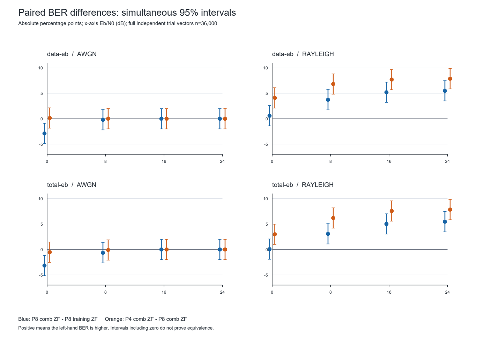
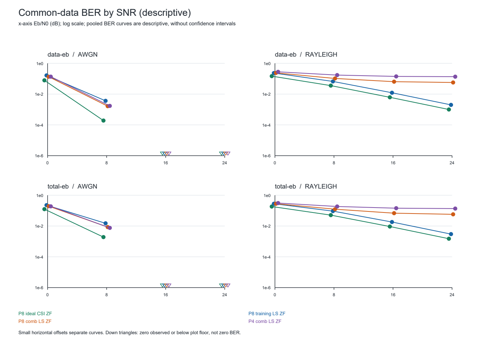
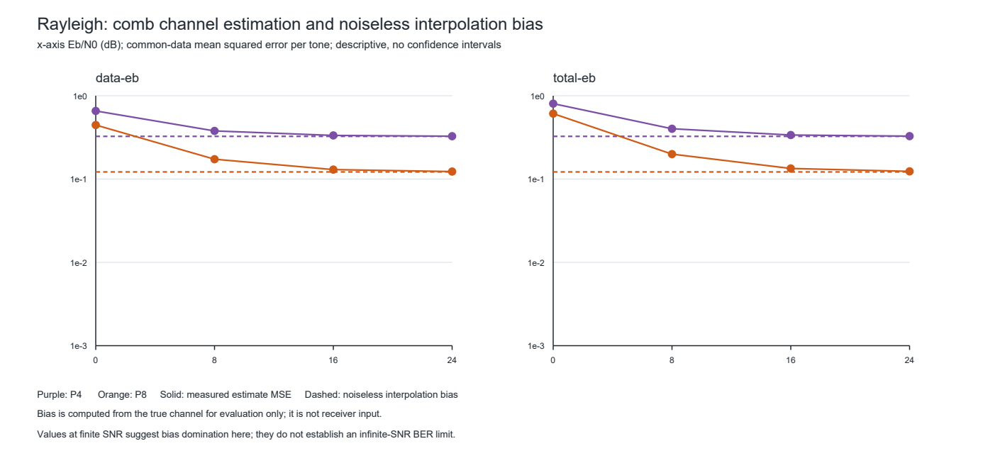

# SignalLab AI v1.3 OFDM 正式研究技术报告
**正式研究报告。** 数据和图表来自已封存的正式研究；未重新抽样、改动原始批次或增加主比较。

## 1. 目标与研究范围

比较指定 SISO CP-OFDM 模型中理想 CSI、全训练符号 LS 与梳状导频 LS 加复数线性插值，并保留 ZF 与增益感知 MMSE。预注册主分析聚焦 32 项 ZF 配对 BER 差；其他 BER、信道估计 MSE 和插值偏差是描述性指标。
这是一个固定参数、固定功率时延谱下的仿真研究，不代表所有频率选择性信道、调制方式或移动速度。结果中的实测事实、公式推导和可能机制分别标注。

## 2. 数学模型与接收方法

[协议/推导] 采用单位酉 128 点 FFT/IFFT、QPSK、连续时域线性多径卷积、长度 16 的 CP 和每帧 4 个数据 OFDM 符号。Rayleigh 抽头在一帧内静态，时延为 0、1、3、7，平均功率按冻结功率时延谱归一化。CP 16 ≥ 最大时延 7，因此帧内去 CP 后在模型适用条件下满足 Y[k]=H[k]X[k]+W[k]。
[协议/推导] 全训练符号使用 LS；梳状导频先计算 Ĥ[p]=Y[p]/P[p]，再按真实有符号频率坐标分别线性插值实部和虚部。96 个占用载波包括两端导频；P4 和 P8 分别在每个数据符号占 4/96 和 8/96 个导频资源。共同比较范围为 86 个数据载波、4 个符号、QPSK 共 688 bit/trial。接收机不使用真实信道；真值只用于研究评价。
[协议/推导] 同一 CSI 下的标量 SISO ZF 与正确处理收缩增益的 MMSE，其非擦除未编码硬判决应一致；本研究不把 MMSE 收缩表述为 BER 改善。两种布局与方法均保留同一个全训练符号，训练、导频及 CP 都计入发送能量；不能把共享发送帧的对比解释为省掉训练或导频。

## 3. 实验协议与统计方法

[冻结方案] 0、8、16、24 dB；AWGN 与该固定 Rayleigh 信道；data Eb/N0 和 total Eb/N0 两种口径。每 80 帧为一批，每组两种能量口径配对，共 450 组、900 批；独立统计分母为 36,000 个完整 trial 向量，相关载波、比特、条件及能量口径不能当作额外独立样本。
[冻结方案] 两种对比均在共同数据位置上按完整 trial 计算：对比 0 为 P8 梳状 ZF − P8 全训练 ZF；对比 1 为 P4 梳状 ZF − P8 梳状 ZF。正差表示左侧 BER 更高。对应 2 个信道 × 4 个 SNR × 2 个能量口径 × 2 个对比，共 32 项。
[推导] 对每帧差 D∈[−1,1] 使用双侧 [Hoeffding 界](https://www.tandfonline.com/doi/abs/10.1080/01621459.1963.10500830)，再对 32 项采用 Bonferroni：半宽 sqrt(2 ln(2×32/0.05)/36000)=0.0199368661。全家族同时置信度为 95%，依赖帧独立模型与 PRNG 近似；不同种子本身不能证明随机独立性。
[定义] data Eb/N0 与 total Eb/N0 不等价；后者按布局的预期总能量除以实际数据比特数，包含训练、导频及 CP。相同数值 SNR 在两种口径下不代表相同噪声方差。

## 4. 完整性、审计与运行限制

[已验证] 独立审计再次读取原始批次及备份，验证清单、协议、源码快照、SHA-256、连续 checkpoint、资源账、结算报告及 32 项统计：450 组、36000 个 trial、32 项主比较；失败 trial 为 0，主比较未知误码位为 0。没有删减异常样本。
[已验证] 本次另一次只读聚合逐文件重新核对批次 hash，并将每项配对差的整数错误位之差与独立审计结果逐项比对。中断前最后提交组为零基 192（15,440 trial），其 checkpoint hash 与恢复后零基 193 组的 previous 一致；恢复继续原有索引。一个中断时留下的空 pending 目录保留，未计入结果。
[已验证及限制] 第一次采集会话因守卫递归枚举与目录原子发布竞争而停止；已按同一 Manifest 恢复，预付时间不退还。该异常会话的最终生命周期内存峰值未封存，最后采样峰值约 316.2 MiB；不得把采样值冒充最终峰值。恢复采集会话原生生命周期峰值 322.64 MiB。包含准备、采集、恢复和结算后复核，累计预付 3,390 秒；归档及备份约 8.02 GiB。不能声称异常会话的完整峰值合规证据已补齐。Node 原始会话日志保留在本地归档中，但宿主错误只在会话工具输出中捕获；本地保存的文字转写不等同于原始 stderr 字节文件。
[锚点] Manifest SHA-256 `c103f9ec646460c0101dc29aca1e0b4a41f5966a2eed0bafca9df0bba8dc64fc`；最终 checkpoint 链头 `06a0638065b28c722ccd59fac94306b59ff0577e05e8ec0931c19907ae634015`。SHA 链能检出损坏，但不能单独防止整份归档及锚点一起被替换；备份在同一卷，不是异地备份。

## 5. 32 项预注册主比较

差值和区间以下均使用绝对 BER 单位。方向为正/负仅表示对应同时区间排除零；包含零记为未判定，不是算法等效。

| 能量口径 | 信道 | dB | 对比 | BER 差 | 同时 95% 区间 | 方向 |
| --- | --- | ---: | ---: | ---: | --- | --- |
| data-eb | awgn | 0 | 0 | -0.029034 | [-0.048971, -0.009097] | negative |
| data-eb | awgn | 0 | 1 | +0.001362 | [-0.018575, +0.021299] | unresolved |
| data-eb | awgn | 8 | 0 | -0.002015 | [-0.021952, +0.017922] | unresolved |
| data-eb | awgn | 8 | 1 | +0.000072 | [-0.019864, +0.020009] | unresolved |
| data-eb | awgn | 16 | 0 | +0.000000 | [-0.019937, +0.019937] | unresolved |
| data-eb | awgn | 16 | 1 | +0.000000 | [-0.019937, +0.019937] | unresolved |
| data-eb | awgn | 24 | 0 | +0.000000 | [-0.019937, +0.019937] | unresolved |
| data-eb | awgn | 24 | 1 | +0.000000 | [-0.019937, +0.019937] | unresolved |
| data-eb | rayleigh | 0 | 0 | +0.005849 | [-0.014088, +0.025786] | unresolved |
| data-eb | rayleigh | 0 | 1 | +0.041038 | [+0.021101, +0.060975] | positive |
| data-eb | rayleigh | 8 | 0 | +0.037280 | [+0.017343, +0.057217] | positive |
| data-eb | rayleigh | 8 | 1 | +0.068238 | [+0.048301, +0.088175] | positive |
| data-eb | rayleigh | 16 | 0 | +0.051929 | [+0.031992, +0.071866] | positive |
| data-eb | rayleigh | 16 | 1 | +0.077010 | [+0.057074, +0.096947] | positive |
| data-eb | rayleigh | 24 | 0 | +0.054920 | [+0.034983, +0.074857] | positive |
| data-eb | rayleigh | 24 | 1 | +0.078622 | [+0.058685, +0.098559] | positive |
| total-eb | awgn | 0 | 0 | -0.031572 | [-0.051509, -0.011636] | negative |
| total-eb | awgn | 0 | 1 | -0.005385 | [-0.025322, +0.014552] | unresolved |
| total-eb | awgn | 8 | 0 | -0.006506 | [-0.026443, +0.013431] | unresolved |
| total-eb | awgn | 8 | 1 | -0.000961 | [-0.020898, +0.018976] | unresolved |
| total-eb | awgn | 16 | 0 | +0.000000 | [-0.019937, +0.019937] | unresolved |
| total-eb | awgn | 16 | 1 | +0.000000 | [-0.019937, +0.019937] | unresolved |
| total-eb | awgn | 24 | 0 | +0.000000 | [-0.019937, +0.019937] | unresolved |
| total-eb | awgn | 24 | 1 | +0.000000 | [-0.019937, +0.019937] | unresolved |
| total-eb | rayleigh | 0 | 0 | +0.000644 | [-0.019293, +0.020581] | unresolved |
| total-eb | rayleigh | 0 | 1 | +0.029878 | [+0.009941, +0.049815] | positive |
| total-eb | rayleigh | 8 | 0 | +0.030848 | [+0.010911, +0.050784] | positive |
| total-eb | rayleigh | 8 | 1 | +0.061897 | [+0.041960, +0.081834] | positive |
| total-eb | rayleigh | 16 | 0 | +0.050186 | [+0.030249, +0.070123] | positive |
| total-eb | rayleigh | 16 | 1 | +0.075636 | [+0.055700, +0.095573] | positive |
| total-eb | rayleigh | 24 | 0 | +0.054643 | [+0.034706, +0.074579] | positive |
| total-eb | rayleigh | 24 | 1 | +0.078395 | [+0.058458, +0.098331] | positive |

图 1：纵轴为绝对百分点，横轴为 Eb/N0 dB；蓝色为对比 0，橙色为对比 1。图中的误差棒是同时置信区间，不是单条 BER 曲线的区间。
[下载图 1 矢量版](signallab-v13-study-results/figure-1-ber-differences-v2.svg)

## 6. 结果与通信理论

[已验证] 32 项中 14 项区间完全为正、2 项完全为负、16 项包含零。Rayleigh 下，P4−P8 在两个能量口径的四个 SNR 均为正；P8 梳状−全训练在 8、16、24 dB 为正，0 dB 未判定。AWGN 下只有 0 dB 的 P8 梳状−全训练在两个口径为负，其余主比较区间均包含零。
[已验证] data Eb/N0、Rayleigh、8 dB 时，P4 梳状 BER 为 17.215%，P8 为 10.391%；差为约 +6.824 个百分点，同时区间 [+4.830, +8.818] 个百分点。较低 BER 是此配置下的差异，工程价值仍取决于额外导频资源、吞吐量及系统要求。
[已验证] data Eb/N0、AWGN、0 dB 时，P8 梳状−全训练为约 −2.903 个百分点，区间 [−4.897, −0.910]；这不意味着所有信道或 SNR 下梳状都优于全训练。
[理论一致性，描述性] data Eb/N0、AWGN 理想 CSI 的观察 BER 在 0/8 dB 为 0.07864131/0.00019085；QPSK AWGN 理论 Q(sqrt(2 Eb/N0)) 分别为 0.07864960/0.00019091。数值接近属于模型核对，不是新设的显著性检验。
[机制推测] 平坦 AWGN 频响下，线性插值对常数响应没有频率插值偏差；多个带噪导频的插值可能降低部分位置的估计噪声。这个机制与低 SNR 观察方向相容，但此项研究未单独建立因果分解，也不保证跨配置成立。

图 2：BER 是描述性汇总，未附单算法置信区间。空心向下三角表示零个观察错误或低于绘图下限，不能当作真实零 BER。
[下载图 2 矢量版](signallab-v13-study-results/figure-2-ber-snr-v2.svg)

## 7. 插值偏差和高 SNR 边界

[已验证，描述性] 固定 Rayleigh 配置、data Eb/N0 24 dB：P4 每载波梳状估计 MSE=0.326757，无噪声插值偏差项=0.325391，理论导频噪声项=0.001316；P8 分别为 0.122996、0.121703、0.001287。偏差项使用真实信道做离线评价，不是接收机输入。
[已验证，描述性] 同一条件下 P4/P8 梳状 BER 分别为 13.554%/5.692%；P8 全训练和理想 CSI 分别为 0.200%/0.100%。这些单方法曲线没有本报告的同时置信区间。
[解释与推测] 该频率选择性配置中，有限高 SNR 点的估计误差接近无噪声插值偏差，且梳状 BER 随 SNR 的改善趋缓，与插值偏差主导的机制相容；但仅凭 0–24 dB 有限点不能证明无穷 SNR 下的 BER 极限或普遍误差底限。P4/P8 的趋势也不能推广到其他导频间隔、PDP 或时变信道。

图 3：实线为估计 MSE，虚线为无噪声插值偏差，均为每共同数据载波的描述性均方量；不附置信区间。
[下载图 3 矢量版](signallab-v13-study-results/figure-3-rayleigh-estimation-v2.svg)

## 8. 失败、擦除与极端样本

[已验证] 完整 trial 无数值失败；共同数据描述记录的擦除位和接收器无效计数为零。预设 deepFadeSymbols 标记为零只表示没有触及实现中的标记阈值，不证明不存在衰落或极端信道。没有按深衰落、错误率或数值大小删样；未提交的中断尝试不构成额外 trial。

## 9. 科学与工程限制

同时区间的绝对半宽约 0.02，能够控制预先指定家族的同时覆盖，但不能保证检测到恰好 0.02 的差异，也无法排除 10⁻³ 级差异。区间包含零不是等效；本方案没有预注册等效界或等效检验。统计方向与工程重要性需要分开判断。
本研究只覆盖冻结的 QPSK、CP 充分、静态块信道、固定 4 抽头 PDP、两套导频和指定 SNR；未研究 CP 不足、其他调制、时间变化、同步误差或真实硬件。原始记录保存逐 trial 汇总和首帧预览，不包含所有时域波形与逐 bit 判决。归档审计器独立验证种子、几何、频响、能量、插值偏差和统计，不对每个带噪接收波形另做完整重仿真；独立 DFT/FIR/Toeplitz 和边界测试提供互补证据。

## 10. 后续方向

如需研究 10⁻³ 级或更小的差异、证明等效，须另行预注册等效界、统计方法、样本量与资源预算。可在新协议中研究不同 PDP、导频布局、CP 不足和时间变化，并先修复资源守卫竞争；不能事后调整本研究的主比较或样本量。

## 附：可复现材料

公开的[统计审计摘要](signallab-v13-study-results/audit-summary.json)、[共同位置指标汇总](signallab-v13-study-results/aggregate.json)、[逐批校验和聚合脚本](signallab-v13-study-results/analyze_archive.py)及[绘图脚本](signallab-v13-study-results/make_figures.py)可用于核对表格和重绘图表。摘要提取自本地独立审计结果，不替代完整审计归档。原始逐 trial 数据、原始日志及私人资料留在本地，因此公开材料不足以让外部读者逐条独立审计原始记录。绘图使用 Python ReportLab；请在新目录放入两份 JSON 后运行脚本，脚本不会覆盖已存在的图。

外部方法背景：Hoeffding 的[有界独立变量和的不等式原文](https://www.tandfonline.com/doi/abs/10.1080/01621459.1963.10500830)；[频率选择性信道中的 OFDM 梳状导频估计](https://ieeexplore.ieee.org/document/663750/)讨论了导频估计及插值方法。这些参考提供方法背景，不作为本次数值实验结果的证据。

工程修复：资源扫描与批次发布的同步修复见 [PR #14](https://github.com/Tutdy66I/CC/pull/14)；截至报告发布时该 PR 已通过 CI、尚未合并。
